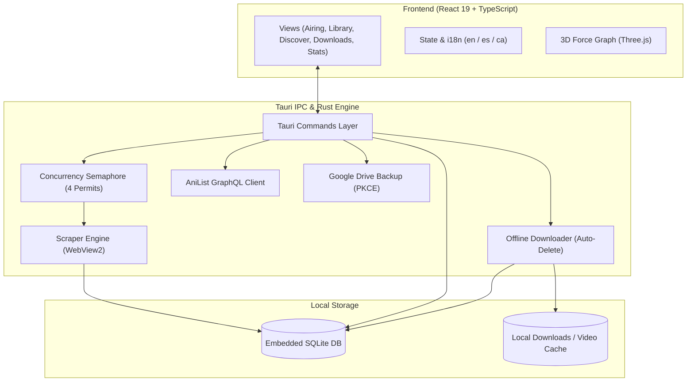

<a id="readme-top"></a>

<!-- PROJECT SHIELDS -->
<div align="center">

[![Latest Release][release-shield]][release-url]
[![Total Downloads][downloads-shield]][downloads-url]
[![Stars][stars-shield]][stars-url]
[![Forks][forks-shield]][forks-url]
[![Issues][issues-shield]][issues-url]
[![License][license-shield]][license-url]
[![Platform][platform-shield]][platform-url]

</div>

<!-- PROJECT LOGO & HEADER -->
<br />
<div align="center">
  <a href="https://github.com/Yearsuck/AnimeOnTrack">
    
  </a>

  

  <p align="center">
    <strong>A high-performance, local-first anime tracker and offline downloader for Windows.</strong>
    <br />
    Tracks currently-airing anime, notifies you the second a new episode drops, downloads episodes for offline viewing (in development), and unifies your progress across six streaming sites — without an account or cloud lock-in.
    <br />
    <br />
    <a href="https://github.com/Yearsuck/AnimeOnTrack/releases/latest"><strong>⬇ Download Installer (v0.10.0) »</strong></a>
    <br />
    <br />
    <a href="#about-the-project">About The Project</a>
    ·
    <a href="#key-features">Key Features</a>
    ·
    <a href="#supported-streaming-sites">Supported Sites</a>
    ·
    <a href="#getting-started">Getting Started</a>
    ·
    <a href="https://github.com/Yearsuck/AnimeOnTrack/issues/new?labels=bug">Report Bug</a>
    ·
    <a href="https://github.com/Yearsuck/AnimeOnTrack/issues/new?labels=enhancement">Request Feature</a>
  </p>
</div>

<!-- TABLE OF CONTENTS -->
<details>
  <summary><strong>Table of Contents</strong></summary>
  <ol>
    <li>
      <a href="#about-the-project">About The Project</a>
      <ul>
        <li><a href="#the-premise">The Premise</a></li>
        <li><a href="#built-with">Built With</a></li>
      </ul>
    </li>
    <li><a href="#key-features">Key Features</a></li>
    <li><a href="#supported-streaming-sites">Supported Streaming Sites</a></li>
    <li>
      <a href="#getting-started">Getting Started</a>
      <ul>
        <li><a href="#prebuilt-binaries">Prebuilt Binaries</a></li>
        <li><a href="#prerequisites">Prerequisites</a></li>
        <li><a href="#installation--development">Installation & Development</a></li>
        <li><a href="#build--test-suite">Build & Test Suite</a></li>
      </ul>
    </li>
    <li><a href="#architecture--engineering-highlights">Architecture & Engineering Highlights</a></li>
    <li><a href="#project-layout">Project Layout</a></li>
    <li><a href="#whats-new-in-v0100">What's New in v0.10.0</a></li>
    <li><a href="#previous-release-v090">Previous release: v0.9.0</a></li>
    <li><a href="#previous-release-v080">Previous release: v0.8.0</a></li>
    <li><a href="#contributing">Contributing</a></li>
    <li><a href="#a-note-on-piracy">A Note on Piracy</a></li>
    <li><a href="#disclaimer">Disclaimer</a></li>
    <li><a href="#license">License</a></li>
    <li><a href="#acknowledgments">Acknowledgments</a></li>
  </ol>
</details>

---

## About The Project

### The Premise

Streaming sites host almost every title currently airing, but their catalogs and release schedules sit behind Cloudflare anti-bot verification. Standard HTTP clients hit `403 Forbidden` because passing the Turnstile/JavaScript challenge requires a real, modern rendering engine.

**AnimeOnTrack** embeds a hidden WebView2 browser instance to transparently solve challenges, parses the rendered DOM inside native Rust, and alerts you the instant an episode drops for any series in your library. You decide what to watch; the app handles the tracking.

Crucially, the app maintains an **offline mirror of the AniList catalog (~22,000 titles)** inside an embedded SQLite database. Browsing, filtering, franchise aggregation, and deck discovery run locally at sub-millisecond speeds — the streaming site is only queried when strictly required.

<p align="right">(<a href="#readme-top">back to top</a>)</p>

### Built With

* [![Tauri][tauri-shield]][tauri-url]
* [![Rust][rust-shield]][rust-url]
* [![React][react-shield]][react-url]
* [![TypeScript][typescript-shield]][typescript-url]
* [![Vite][vite-shield]][vite-url]
* [![SQLite][sqlite-shield]][sqlite-url]
* [![Three.js][threejs-shield]][threejs-url]

<p align="right">(<a href="#readme-top">back to top</a>)</p>

---

## Key Features

### 💾 Offline Episode Downloads & Auto-Cleanup
* **Per-series downloads panel**: download one episode, **every pending episode of a series** (oldest first, one transfer at a time), cancel a running one, play it offline, or delete a series' downloads **without touching its watched state**.
* **Five sites, many hosts**: TioAnime, JKAnime, animeyt.cc, GogoAnime and the new AnimeFLV, through Mp4upload, YourUpload, Mediafire, Streamtape, Mixdrop, Vidhide, VOE, Ok.ru and direct mp4 players, plus a built-in HLS downloader for stream-only hosts. See [`docs/superpowers/plans/2026-10-14-download-sources-research.md`](docs/superpowers/plans/2026-10-14-download-sources-research.md) for what each site serves and what cannot be done (captcha, encrypted or anti-bot hosts).
* **Quarantine before a file is kept**: every download is a `.part` until it is a real video container (MP4, MPEG-TS or Matroska; the extension comes from the bytes, never the URL) and Windows Defender finds nothing. Kept files get the Mark of the Web and the downloads folder denies *execute* on its files. This is hardening, not a virtual machine.
* **Auto-Delete on Seen**: the local file is removed once the episode is marked watched.

### 🖼️ AniList Spotlight & Landscape Banners
* **Wide Cinematic Banners**: The Airing Spotlight carousel fetches high-definition landscape banners directly from AniList's GraphQL API.
* **Graceful Cover Fallback**: Automatic fallback to high-resolution portrait posters whenever an official banner is unavailable.

### ⚡ Intelligent Airing Detection
* **Sub-2-Second Quiet Scans**: Release schedule heuristics skip titles that cannot have updated yet, cutting refresh cycles from ~510s down to ~1.5s.
* **App-Wide Semaphore**: Scraper requests are capped to 4 concurrent permits, eliminating bot-detection triggers and WebView2 IPC stalls.

### 🔗 Canonical Tracking Across 6 Streaming Sites
* **Unified Watch History**: Followed series, watched episodes, and backlogs are shared canonically across all supported sites using AniList ID resolution.
* **Seamless Site Switching**: Switching between streaming providers updates video links without disturbing your library progress or statistics.
* **Automatic Mirror Failover**: Each adapter contains a fallback mirror list that automatically bypasses dead domains or DNS takedowns.

### 🃏 Discover Swipe Deck with Multi-Level Undo
* **Tinder-Style Swiping**: Rapidly sort recommendations into *Want*, *Seen*, or *Discard* with keyboard shortcuts or mouse gestures.
* **Taste-Weighted Algorithm**: Surfaces recommendations based on your completed and high-rated franchises.
* **Precision Filtering**: Filter by release date ranges (including future upcoming releases), score floor, formats (TV, Movie, OVA, ONA), and genres, backed by a ~5-step undo history.
* **Watchlist Manager**: The Want / Discarded / Seen lists open as a grid or dense list with score, year, format, status and genre filters, sorting, quick groups and bulk actions.

### 📊 Watch Insights & Interactive 3D Force Graph
* **Comprehensive Stats**: View total hours watched, completion percentages, activity timelines, and genre distributions.
* **Franchise Rollups**: Multi-season epics (e.g., *One Piece*, *Boruto*) consolidate into single franchises instead of fragmented arcs.
* **3D Knowledge Graph**: Explore your entire anime universe with an interactive, GPU-accelerated 3D force-directed graph powered by Three.js: node and link weights follow watched episodes, click to select, right-click for a context menu.
* **Yearly Activity Heatmap**: A full-year contribution-style grid with quartile-based intensity levels.

### ☁️ Encrypted Google Drive Backup
* **Zero Cloud Lock-In**: End-to-end database backups saved to a private, hidden folder in your own Google Drive.
* **PKCE OAuth**: Easy one-click setup directly within Settings without custom compilation or baked-in secrets.
* **Cross-Machine Migration**: Restoring on a fresh installation detects your snapshot and stages it safely.

### 🌐 Tri-Lingual Support
* Full localization in **English (`en`)**, **Spanish (`es`)**, and **Catalan (`ca`)**, verified at compile time with 100% key coverage.

<p align="right">(<a href="#readme-top">back to top</a>)</p>

---

## Supported Streaming Sites

Six adapters are bundled out of the box, all conforming to a pluggable `SiteAdapter` interface:

| Site | Default Domain | Adapter ID | Primary Language | Offline downloads |
|:---|:---|:---|:---:|:---:|
| **AnimeYT** | `animeyt.cc` | `animeytx` | Spanish (Castilian / LatAm) | direct mp4 player |
| **TioAnime** | `tioanime.com` | `tioanime` | Spanish (Castilian / LatAm) | YourUpload, Mp4upload, Ok.ru… |
| **AnimeFLV** | `animeflv.or.at` | `animeflv` | Spanish (Castilian / LatAm) | Mp4upload, VOE |
| **JKanime** | `jkanime.net` | `jkanime` | Spanish (Castilian / LatAm) | Mp4upload, Mediafire, Mixdrop, Vidhide, VOE… |
| **GogoAnime** | `gogoanime.by` | `gogoanime` | English (Sub / Dub) | HLS |
| **AnimeLand** | `w7.animeland.tv` | `animeland` | English (Dubbed) | not possible (see research doc) |

Every adapter keeps a per-site mirror list that fails over automatically when a domain dies. AnimeFLV moved to a new WordPress site (`animeflv.or.at`) in October 2026; existing installs are migrated to it on first launch.

> [!TIP]
> Adding support for a new site requires only a single `SiteInfo` registry entry and a `SiteAdapter` implementation — no frontend modifications required.

<p align="right">(<a href="#readme-top">back to top</a>)</p>

---

## Getting Started

### Prebuilt Binaries

1. Navigate to the [**Releases Page**](https://github.com/Yearsuck/AnimeOnTrack/releases/latest).
2. Download the latest Windows setup installer (`AnimeOnTrack_*_x64-setup.exe` or `.msi`).
3. Run the installer. On first launch, select your preferred streaming site in **Settings** and initiate your initial library scan.

> [!NOTE]
> macOS and Linux builds compile via Tauri stubs, but automated Cloudflare bypass scraping is currently exclusive to Windows via WebView2 (refer to [`docs/cross-platform-porting.md`](docs/cross-platform-porting.md)).

### Prerequisites

To build AnimeOnTrack from source, ensure your environment has:

* **[Rust](https://rustup.rs/)** (stable toolchain, `x86_64-pc-windows-msvc`)
* **[Node.js](https://nodejs.org/)** (v18+ with `npm`)
* **Visual Studio 2022 Build Tools** with the *Desktop development with C++* workload (required for compiling bundled SQLite from C via `rusqlite`)

### Installation & Development

1. Clone the repository and checkout the `develop` branch:
   ```bash
   git clone https://github.com/Yearsuck/AnimeOnTrack.git
   cd AnimeOnTrack
   ```

2. Install frontend dependencies:
   ```bash
   npm install
   ```

3. Launch the desktop application with live hot-reloading:
   ```bash
   npm run tauri dev
   ```

### Build & Test Suite

Verify both backend and frontend layers prior to opening pull requests:

```bash
# Rust backend: Run all 900+ automated unit & integration tests
cargo test --manifest-path src-tauri/Cargo.toml

# Rust backend: Strict linter check
cargo clippy --manifest-path src-tauri/Cargo.toml --all-targets -- -D warnings

# Frontend: Typecheck, unit tests (Vitest) & production bundle build
npx tsc --noEmit
npm test
npm run build
```

<p align="right">(<a href="#readme-top">back to top</a>)</p>

---

## Architecture & Engineering Highlights



* **WebView2 vs. `reqwest`**: Cloudflare Turnstile blocks spoofed User-Agents. AnimeOnTrack instantiates a hidden WebView2 window, lets the challenge execute legitimately, and harvests rendered HTML back into Rust.
* **Global Concurrency Semaphore**: All scraping tasks share a single 4-permit semaphore. This prevents rate-limiting IP bans and avoids IPC deadlocks.
* **Strict Gap-Free Progression**: Marking episode 12 as seen automatically marks episodes 1 through 11; un-marking episode 12 cascades forward. Numbering parsers gracefully handle notations like `1x05`, `12.5`, and multi-part specials.
* **Smart Airing Skip Predicate**: Refreshes skip series that cannot mathematically have updated based on their broadcast schedule, speeding up typical background checks to ~1.5s.
* **Local-First SQLite Database**: The application database lives locally at `%APPDATA%\com.animeontrack.app\animeontrack.sqlite`. No telemetry or mandatory cloud connections.

<p align="right">(<a href="#readme-top">back to top</a>)</p>

---

## Project Layout

```text
AnimeOnTrack/
├── src-tauri/
│   ├── src/
│   │   ├── adapter/         # SiteAdapter trait and 6 streaming implementations
│   │   ├── backup/          # Google Drive OAuth (PKCE), snapshot, and staged restore
│   │   ├── commands/        # Tauri command handlers (app API surface)
│   │   ├── db/              # rusqlite schema, migrations, queries, and catalog indexing
│   │   ├── anilist.rs       # AniList GraphQL sync, landscape banner & metadata resolver
│   │   ├── anizip.rs        # ani.zip episode map (per-season vs absolute numbering, air dates)
│   │   ├── catalog_snapshot.rs # gzip snapshot of the whole catalog for a fast first run
│   │   ├── download_sources.rs # Pure parsers: server lists and file hosts -> a downloadable link
│   │   ├── downloader.rs    # Streams a file or an HLS stream to disk (.part -> checks -> rename)
│   │   ├── download_safety.rs # Content sniffing, Defender scan, Mark of the Web, no-execute folder
│   │   ├── hls.rs           # HLS playlist parsing and the GogoAnime player chain
│   │   ├── ad_block.rs      # Ad/tracker request blocking in the app's viewer windows
│   │   ├── domain_breaker.rs# Backs off hosts that keep failing
│   │   ├── file_log.rs      # Small rotating aot.log
│   │   ├── matching.rs      # Fuzzy and exact title matching algorithms
│   │   ├── player.rs        # Dedicated viewer window lifecycle (maximised, ads blocked)
│   │   └── scraper_engine.rs# Hidden WebView2 challenge solver & canvas cover decoder
│   ├── Cargo.toml           # Rust backend dependencies & build settings
│   └── tauri.conf.json      # Tauri application bundle configuration
├── src/
│   ├── components/          # Reusable design system primitives & UI widgets
│   ├── i18n/                # Zero-dependency catalog with full en/es/ca coverage
│   ├── views/               # Screen views (Airing, Library, Discover, Downloads, Stats)
│   ├── api.ts               # Strongly-typed wrapper over window.__TAURI__.invoke
│   └── styles.css           # Custom design system tokens, typography, and dark/light themes
├── docs/                    # Technical documentation and platform guides
└── package.json             # Frontend dependencies & scripts
```

<p align="right">(<a href="#readme-top">back to top</a>)</p>

---

## What's New in v0.10.0

* **In-app updates**: the app checks GitHub for a newer release shortly after start (switchable in Settings → Appearance, with a manual "Check now") and offers *Install and restart*. Nothing installs without a click, and every installer is signed; the app verifies the signature against the public key in `tauri.conf.json`. 0.10.0 is the first release that ships it, so it has to be installed by hand once; from then on new versions arrive by themselves.

<p align="right">(<a href="#readme-top">back to top</a>)</p>

---

## Previous release: v0.9.0

Details of each change and how it was tested: [`docs/new-additions-review.md`](docs/new-additions-review.md).

* **Offline downloads**, per series, with a quarantine for every file (see *Key Features*), five sites and a built-in HLS downloader.
* **Fast first run**: a new install imports a 2.8 MB gzip snapshot of the catalog (22,600 titles in about 4 s) instead of crawling AniList for 15+ minutes; the crawl remains as the fallback. Until the snapshot is published as a release asset (`catalog-snapshot`) the crawl is used.
* **Faster AniList crawl**: ten pages per request, pacing that counts the request time and the pre-2000 years crawled by decade — the full 22,600-title sync dropped from 15+ min to about 3 min.
* **A smoother app**: every command runs off the UI thread, the 3D graph code loads only when Estadísticas opens, the catalog list no longer rebuilds dozens of pages on return, and the dev build optimises SQLite.
* **Discover**: deck filters apply on their own and can be reset; a popular ↔ niche slider and tag/studio-aware recommendations; the slider is hidden in random mode.
* **Catalog**: start watching a series (it moves to Pendientes) straight from the selection bar.
* **Smaller things**: next-episode air date on the series screen (ani.zip), per-episode number alignment across sites, keyboard shortcuts (`?`), a Windows toast for new episodes, export diagnostics + a rotating `aot.log`, ad and pop-up blocking in the app's own windows, and the AniList page opening inside the app.

## Previous release: v0.8.0

* **AniList is the source of truth**: titles, covers and metadata come from AniList for every linked series; the streaming sites only supply episode links and the airing signal.
* **animeyt.cc relaunch supported** with its new `aniyt` theme; old `*.animeytx.net` URLs are migrated on startup.
* **Site priority**: order the six sites and the app opens the episode from the highest-priority site that has it.
* **Pendientes merges sites per episode number**: the same episode on two sites shows once; a show's missing episodes are fetched from another site when its own listing lags.
* **Season relink**: a listed multi-season row follows the season that is actually releasing.

*(For detailed historical release notes, see the [Releases](https://github.com/Yearsuck/AnimeOnTrack/releases) tab).*

<p align="right">(<a href="#readme-top">back to top</a>)</p>

---

## Contributing

Contributions are what make the open source community such an amazing place to learn, inspire, and create. Any contributions you make are **greatly appreciated**.

This project follows the **Gitflow** branching workflow:
* `main`: Production-ready, tagged releases only (`vX.Y.Z`).
* `develop`: Active integration branch.
* `feat/*`, `fix/*`, `docs/*`: Short-lived feature and bugfix branches.

### Workflow

1. Fork the Project.
2. Create your Feature Branch off `develop`:
   ```bash
   git checkout develop
   git checkout -b feat/AmazingFeature
   ```
3. Commit your Changes using [Conventional Commits](https://www.conventionalcommits.org/):
   ```bash
   git commit -m "feat(scraper): add support for new streaming provider"
   ```
4. Verify tests and linting:
   ```bash
   cargo test --manifest-path src-tauri/Cargo.toml
   npm run build
   ```
5. Push to your branch:
   ```bash
   git push origin feat/AmazingFeature
   ```
6. Open a Pull Request targeting `develop`.

<p align="right">(<a href="#readme-top">back to top</a>)</p>

---

## A Note on Piracy

I'll say this plainly: I always advocate paying for the content you watch. Creators, studios, and the people who make anime don't live on air — if you can support them officially, you should, and I do.

Spanish- and English-language anime piracy has, for decades, been the **first door into anime** for most fans outside Japan. Without fansubs and community streaming, the medium simply would not be as global, accessible, or beloved as it is today. Furthermore, plenty of older and niche titles are never licensed or distributed officially in given regions — so for those, "just pay for it" simply isn't an option. You cannot support what nobody is selling you.

Support creators wherever you actually can, and understand this tool for what it is: a tracker built by someone who loves the medium, not an excuse to skip the official release when one exists.

<p align="right">(<a href="#readme-top">back to top</a>)</p>

---

## Disclaimer

AnimeOnTrack is an independent, open-source software project. It interacts with third-party streaming sites that the author does not operate, host, or endorse. The application stores no copyrighted media files on remote servers and hosts no streaming content — it parses publicly-rendered web pages to detect release updates and opens playback links in an isolated browser window. Users are solely responsible for their use of the software and compliance with local laws and regulations.

<p align="right">(<a href="#readme-top">back to top</a>)</p>

---

## License

Distributed under the **GNU General Public License v3.0 or later**. See [`LICENSE`](LICENSE) for more information.

```text
AnimeOnTrack - Cross-site anime tracker and manager
Copyright (C) 2026 Yearsuck and contributors

This program is free software: you can redistribute it and/or modify
it under the terms of the GNU General Public License as published by
the Free Software Foundation, either version 3 of the License, or
(at your option) any later version.
```

<p align="right">(<a href="#readme-top">back to top</a>)</p>

---

## Acknowledgments

* [othneildrew/Best-README-Template](https://github.com/othneildrew/Best-README-Template) — for the outstanding README structure and inspiration.
* [AniList API v2](https://anilist.gitbook.io/anilist-api-v2-docs/) — for providing comprehensive anime metadata and banner artwork.
* [Tauri](https://tauri.app/) — for delivering a lightweight, secure native desktop shell.
* [rusqlite](https://github.com/rusqlite/rusqlite) & [SQLite](https://www.sqlite.org/) — for rock-solid embedded local data persistence.
* [react-force-graph-3d](https://github.com/vasturiano/react-force-graph) & [Three.js](https://threejs.org/) — for 3D library visualization.
* [Capsule Render](https://github.com/kyechan99/capsule-render) — for dynamic SVG banner artwork.
* [Shields.io](https://shields.io/) — for dynamic GitHub status badges.

<p align="right">(<a href="#readme-top">back to top</a>)</p>

<div align="center">
  
</div>

<!-- MARKDOWN LINKS & IMAGES -->
[release-shield]: https://img.shields.io/github/v/release/Yearsuck/AnimeOnTrack?style=for-the-badge&color=4aa8ff&labelColor=0b1521&label=release
[release-url]: https://github.com/Yearsuck/AnimeOnTrack/releases/latest
[downloads-shield]: https://img.shields.io/github/downloads/Yearsuck/AnimeOnTrack/total?style=for-the-badge&color=46d19e&labelColor=0b1521&label=downloads
[downloads-url]: https://github.com/Yearsuck/AnimeOnTrack/releases
[stars-shield]: https://img.shields.io/github/stars/Yearsuck/AnimeOnTrack.svg?style=for-the-badge&color=4aa8ff&labelColor=0b1521
[stars-url]: https://github.com/Yearsuck/AnimeOnTrack/stargazers
[forks-shield]: https://img.shields.io/github/forks/Yearsuck/AnimeOnTrack.svg?style=for-the-badge&color=4aa8ff&labelColor=0b1521
[forks-url]: https://github.com/Yearsuck/AnimeOnTrack/network/members
[issues-shield]: https://img.shields.io/github/issues/Yearsuck/AnimeOnTrack.svg?style=for-the-badge&color=4aa8ff&labelColor=0b1521
[issues-url]: https://github.com/Yearsuck/AnimeOnTrack/issues
[license-shield]: https://img.shields.io/badge/license-GPL--3.0--or--later-46d19e?style=for-the-badge&labelColor=0b1521
[license-url]: https://github.com/Yearsuck/AnimeOnTrack/blob/main/LICENSE
[platform-shield]: https://img.shields.io/badge/platform-Windows%2010%20%7C%2011-e9eff5?style=for-the-badge&logo=windows11&logoColor=0b1521&labelColor=0b1521
[platform-url]: https://github.com/Yearsuck/AnimeOnTrack/releases

[tauri-shield]: https://img.shields.io/badge/Tauri_2-24C8D8?style=for-the-badge&logo=tauri&logoColor=white
[tauri-url]: https://tauri.app/
[rust-shield]: https://img.shields.io/badge/Rust_stable-DEA584?style=for-the-badge&logo=rust&logoColor=black
[rust-url]: https://www.rust-lang.org/
[react-shield]: https://img.shields.io/badge/React_19-20232A?style=for-the-badge&logo=react&logoColor=61DAFB
[react-url]: https://react.dev/
[typescript-shield]: https://img.shields.io/badge/TypeScript-3178C6?style=for-the-badge&logo=typescript&logoColor=white
[typescript-url]: https://www.typescriptlang.org/
[vite-shield]: https://img.shields.io/badge/Vite-646CFF?style=for-the-badge&logo=vite&logoColor=white
[vite-url]: https://vitejs.dev/
[sqlite-shield]: https://img.shields.io/badge/SQLite_3-003B57?style=for-the-badge&logo=sqlite&logoColor=white
[sqlite-url]: https://www.sqlite.org/
[threejs-shield]: https://img.shields.io/badge/Three.js-000000?style=for-the-badge&logo=three.js&logoColor=white
[threejs-url]: https://threejs.org/
