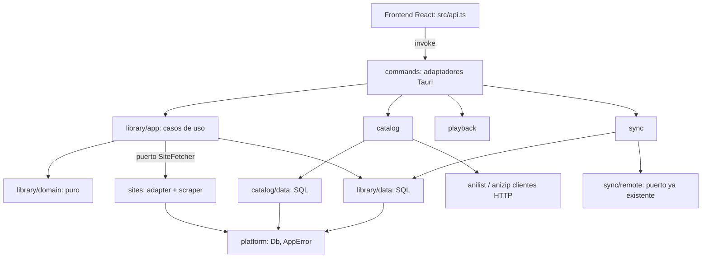

# Auditoria de arquitectura, 2026-11-27

Alcance: backend Rust `src-tauri/src` y la frontera del frontend `src/` con Tauri. Medido sobre la rama
`chore/arch-audit` (= `develop` tras v0.26.0, ~92.5k lineas Rust+TS segun `wc -l`). Cada cifra sale de un
comando (`wc -l`, `grep -rn`, `awk` por funcion); las rutas `archivo:linea` son las del arbol actual.

Veredicto corto: el producto funciona y esta bien probado (cientos de tests de dominio), pero tiene **una sola
capa gorda**: `commands/*` hace de controlador, caso de uso, orquestador de red y a veces SQL, y `db/*` mezcla
SQL con reglas de negocio. No hace falta reescribir: hay costuras reales (trait `SiteAdapter`, `sync/remote.rs`,
`domain_breaker.rs`, `matching.rs` puro) sobre las que estrangular.

## 1. Mapa de riesgo y deuda tecnica

### Medidas de base

| Medida | Dato | Fuente |
|---|---|---|
| Ficheros mas grandes (lineas) | `db/stats.rs` 7097, `db/catalog.rs` 5637, `db/series.rs` 4063, `db/airing.rs` 3044, `db/episodes.rs` 2921, `download_sources.rs` 2680, `matching.rs` 2628 | `wc -l` |
| Codigo de produccion (hasta el primer `#[cfg(test)]`) | stats 2818 de 7097, airing 993 de 3044, matching 1430 de 2628, scan 1413 de 1803 | `grep -n '#\[cfg(test)\]'` |
| Funciones mas largas | `commands/scan.rs:920 refresh` 488 l.; `db/stats.rs get_watch_insights` 379; `db/airing.rs list_airing_with_rolled` 247; `commands/download.rs scrape_and_try_siblings` 219; `commands/follow.rs link_series_core` 213 | `awk` por `fn` |
| Comandos Tauri | 106 `#[tauri::command]` en 16 ficheros de `commands/` + `commands.rs` (524 l.) | `grep -c` |
| Errores | 120 firmas `Result<_, String>`; `anyhow` en `Cargo.toml:29`; ningun tipo de error propio ni `thiserror` | `grep` |
| `unwrap()/expect()` fuera de tests | ~282 (parte de produccion de cada fichero); 36 `lock().unwrap()` solo en `commands/scan.rs` | script `head -n <cfg(test)>` |
| Logging | 72 `eprintln!` frente a 52 `log::`/`tracing::` | `grep` |
| Transacciones | 22 usos, todos `unchecked_transaction()` | `grep` |
| Reintentos | AniList: `Retry-After` en `anilist.rs:759-791`; scraping: espejos + `domain_breaker.rs`; sin backoff exponencial ni jitter | `grep -i retry\|sleep` |
| Indices | 5 `CREATE INDEX` en `db.rs` | `grep -c` |
| CI | Rust en 3 SO, clippy `-D warnings` solo Windows; tsc, `npm test`, build en frontend | `.github/workflows/ci.yml` |

### Direccion de dependencias medida

- `db/*` importa `crate::models` (448), `anilist` (132), `matching` (83), `anizip` (67): la capa de datos conoce
  a los clientes de red. Parte son tipos y tests, pero el sentido es incorrecto (sin dominio en medio).
- `db/episodes.rs:1090,1100` llama a `crate::commands::is_safe_file_in_dir` y `remove_empty_dir_in_dir`
  (definida en `commands/storage.rs:75`): **`db` depende de `commands`**, el unico ciclo real de capas.
- `db/extras.rs:108` llama a `crate::adapter::all_sites()` para resolver un nombre: `db` depende de `adapter`.
- `anizip.rs` y `ui_watchdog.rs` importan `crate::commands` (los comandos usados como libreria).
- `matching.rs` y `anilist.rs` no tienen `use crate::` (grep vacio): puros y aislados. Es el activo mas valioso.
- `sync/` solo depende de `sync`, `models`, `db`, `backup`: bien. `adapter/*` no importa `db`: bien.
- Frontend: solo 2 imports de `@tauri-apps/api/core` en todo `src/`; `src/api.ts` (382 l.) es la frontera: bien.

### Critical

**C1. `refresh()` es un monolito de 488 lineas** (`commands/scan.rs:920-1408`). Mezcla keep-alive, resolucion de
sitio y espejos, scraping del listado, curacion de portadas, upsert en bucle, decision skip/fetch
(`should_fetch_series`), un `tokio::join!` de aridad fija (brazos de 1 a 4 en `scan.rs`), persistencia, portadas,
backfill de generos y progreso a la UI. 33 `state.db.lock().unwrap()` en el fichero. *Riesgo de negocio*: es el flujo
que detecta episodios nuevos, la razon de ser del producto; un bug aqui deja Pendientes vacio o con episodios ajenos
(ya paso: v0.24.3, 510 episodios sinteticos, ver `STATE.md`). Por miedo a tocarlo se acumulan condiciones.

**C2. Errores como `String` y `unwrap()` en locks.** 120 `Result<_, String>` pierden la causa (red, parseo, DB,
config); el frontend no puede elegir entre reintentar, reconectar o reportar. Un `Mutex::lock().unwrap()` tras un
panico en otro hilo (lock envenenado) propaga el panico y deja la app sin base de datos hasta reiniciar.
*Riesgo*: cuelgue total tras un solo bug y diagnostico imposible en produccion (de ahi existe `ui_watchdog.rs`).

**C3. Escrituras multi-fila sin transaccion en la ruta caliente.** `refresh` hace `for s in &series { db.upsert_series(...) }`
(`scan.rs`, bloque del listado) y `upsert_series` (`db/series.rs:136`) escribe por fila: un commit por serie, y si el
proceso muere a mitad el listado queda parcial (series nuevas, `mark_unlisted_not_airing` ya aplicado). *Riesgo*:
estado parcial visible en la UI y lentitud en discos lentos/Android. El patron sano ya existe (`db/catalog.rs:253`).

### High

**H1. Ficheros dios en `db/`** (7097/5637/4063/3044/2921 l.). Cada uno mezcla consultas, reglas (rolled dates,
temporadas, pendientes) y tests. Cambiar una regla obliga a leer miles de lineas; revisiones y conflictos caros.
`get_watch_insights` (379 l.) y `list_airing_with_rolled` (247 l.) son reglas de negocio escritas como SQL+bucles.

**H2. Reglas de negocio mezcladas con SQL.** `commands/{follow,seen,fallback,diagnostics}.rs` usan `rusqlite`
directamente (`grep -l rusqlite commands`); 35 lineas con SQL en `commands/` y SQL tambien en `backup/mod.rs`,
`sync/engine.rs`, `commands/mirrors.rs`. *Riesgo*: regresiones de enlace sitio-AniList (`link_series_core`, 213 l. en
`commands/follow.rs`) porque la regla vive repartida en tres capas y solo se prueba contra SQLite real.

**H3. Un unico `Mutex<Db>`** (`commands.rs:87`) compartido con flujos de red largos. Cada comando toma el lock y
`refresh` lo suelta y retoma muchas veces (bloques `{ let db = ...lock(); }` repartidos). *Riesgo*: contencion (UI lenta
mientras se sincroniza el catalogo de ~22k titulos) y bloqueos en Android. Es inferencia por estructura, no medicion.

**H4. Red sin politica comun de reintentos.** AniList respeta `Retry-After` (`anilist.rs:759-791`); `anizip.rs:131,165`
duerme 30 s y 1,5 s con constantes sueltas; `commands/catalog.rs` tiene `PACED_SLEEP` propio (lineas 411, 477, 737, 795,
813); `commands/fallback.rs:126` otro ritmo. Ninguno con backoff exponencial ni jitter ni presupuesto. El circuit breaker
`domain_breaker.rs` es bueno pero solo lo usa `commands/download.rs` (492-496, 774). *Riesgo*: 429 en cascada de AniList
o 20-30 s de timeout por espejo muerto en cada refresh.

**H5. Test flaky por reloj**: `db/airing.rs:2066 timing_test_real_size` inserta 6000 series y 120k episodios y afirma
`< 1500 ms` (`airing.rs:2101-2102`) en build debug. Depende de CPU/disco del runner (3 SO en CI). Mide rendimiento con
el reloj, no con una propiedad. *Riesgo*: CI rojo intermitente que entrena a ignorar CI rojo.

### Medium

- **M1. Logging sin estructura**: 72 `eprintln!("[scan] ...")` sin nivel ni correlacion (`scan.rs` bloque del listado).
  `file_log.rs` existe pero no es la via comun.
- **M2. `unchecked_transaction()` en los 22 usos**: evita el `&mut Connection` pero pierde la garantia de compilacion
  contra transacciones anidadas; `db/episodes.rs:351` tiene que comprobar `is_autocommit()` a mano.
- **M3. Tests inline**: `db/stats.rs` lleva ~4300 lineas de tests (130 `#[test]`) en el mismo fichero (`cfg(test)` en la
  linea 2818); ruido de revision y compilacion incremental.
- **M4. Tipos del frontend a mano**: `src/types.ts` se mantiene a mano frente a `models.rs`; sin generacion, derivan.
- **M5. Diez adaptadores de 590-727 l.** con el trait `SiteAdapter` (`adapter/mod.rs:64`, muchos defaults); fixtures en
  `src-tauri/tests/fixtures`, pero sin suite de contrato comun.
- **M6. N+1**: la ruta caliente de `refresh` ya usa consultas por lote (`max_episode_numbers_for_source`,
  `last_checked_ages_for_source`, ver el comentario en `scan.rs`); no se encontro N+1 abierto ahi. En stats hay muchos
  `prepare` por consulta sin medir; sin `EXPLAIN QUERY PLAN` no afirmo nada (ver "No verificado").

## 2. Arquitectura objetivo (To-Be)

**Monolito modular con contextos acotados dentro del mismo crate.** Primero se mueven ficheros y se fijan reglas de
dependencia; crates separados solo si algun dia la compilacion lo pide.

### Contextos

| Contexto | Responsabilidad | Hoy vive en |
|---|---|---|
| `catalog` | espejo AniList, snapshot, descubrir, recomendaciones | `anilist.rs`, `anizip.rs`, `db/catalog.rs`, `commands/{catalog,discover}.rs`, `recommend.rs`, `swipe.rs`, `genres.rs` |
| `sites` | adaptadores, scraping, espejos, breaker, portadas | `adapter/`, `scraper_engine*`, `domain_breaker.rs`, `html_cache.rs`, `cover_cache.rs`, `commands/mirrors.rs` |
| `library` | series seguidas, episodios, visto, enlace sitio<->AniList, pendientes, emision | `db/{series,episodes,airing,library}.rs`, `matching.rs`, `commands/{follow,seen,library,scan,fallback}.rs` |
| `sync` | fusion entre dispositivos, Drive, backup | `sync/`, `backup/`, `db/sync_state.rs` |
| `playback` | descarga, reproductor limpio, HLS | `download_sources.rs`, `downloader.rs`, `hls.rs`, `clean_player.rs`, `player.rs`, `commands/download.rs` |
| `platform` (kernel) | errores, `Db`, ajustes, log, fechas, modelos | `db.rs`, `db/settings.rs`, `models.rs`, `dates.rs`, `file_log.rs`, `ui_watchdog.rs` |

### Arbol de modulos objetivo

```
src-tauri/src/
  platform/   error.rs (AppError, thiserror)  db.rs (apertura, migraciones)  settings.rs  log.rs
  catalog/    domain/ (titulos, generos, recomendacion: puro)   data/ (SQL)   anilist.rs  anizip.rs   commands.rs
  sites/      adapter/ (trait + 10 sitios)  scraper_engine/  breaker.rs  html_cache.rs  cover_cache.rs
              fetcher.rs (puerto SiteFetcher)  policy.rs (reintentos/backoff comunes)
  library/    domain/ (matching, rolled/pending, refresh_plan: PURO, sin rusqlite)
              app/    (casos de uso: refresh, follow, mark_seen)   data/ (SQL)   commands.rs
  sync/       doc  merge  engine  remote  drive_remote   (ya existe)      backup/
  playback/   download_sources  downloader  hls  clean_player  player  commands.rs
  commands/   solo registro en lib.rs (`generate_handler!`)
```

### Diagrama de dependencias



### Contratos de capa (reglas verificables)

1. `domain` no importa `rusqlite`, `tauri`, `reqwest`, `tokio` ni `data`/`commands`: funciones puras, tests sin DB.
2. `data` (SQL) solo importa `platform` y `models`; nunca `commands`, `adapter`, `anilist` ni `tauri`.
3. `app` orquesta `domain` + `data` + puertos; sin SQL ni `#[tauri::command]`.
4. `commands` toma el lock, llama un caso de uso y convierte `AppError` a `{code, message}`; ~40 lineas maximo.
5. Un caso de uso recibe `&mut Db` o una transaccion, nunca `State<AppState>` ni `Mutex`.
6. Todo `Result` publico usa `AppError`; `String` solo en la frontera Tauri.

### Puertos y adaptadores: solo donde rentan

- **Si, `SiteFetcher`** (traer HTML de un espejo). Hoy `scrape_via_mirrors` (`commands.rs:290`) exige `AppHandle` y
  WebView2, asi que `refresh` no se puede probar sin ventana. Con el puerto, un `FakeFetcher` prueba el flujo entero.
  `sync/remote.rs` ya es un puerto y sirve de plantilla.
- **No, repositorios abstractos sobre SQLite** (`SeriesRepo`...). Un usuario, una base local; `Db::open(":memory:")` ya da
  tests rapidos y fieles. Un trait por tabla duplicaria 100+ firmas sin segundo backend que lo justifique.
- **No, puerto para AniList**: `anilist.rs` ya es puro (sin `crate::`) y se prueba con fixtures de respuesta.

### Rechazado explicitamente

| Idea | Por que no |
|---|---|
| Microservicios | Un binario de escritorio/Android, un usuario, SQLite local; solo anadiria latencia y operacion. |
| Event sourcing / CQRS | La fusion entre dispositivos ya es campo a campo con stamps (`sync/merge.rs`); un log de eventos exigiria migrar datos reales para un problema que no existe. |
| ORM (diesel/sea-orm) | Miles de lineas de SQL probado; riesgo mayor que el beneficio. Se mueve, no se reescribe. |
| Workspace de crates por contexto ya | Coste de reorganizar `Cargo.toml`, `lib.rs` y CI en 3 SO sin ganancia hasta que la compilacion sea cuello de botella. Revisar tras el hito 5. |
| Pool de conexiones | `Mutex<Db>` basta para un usuario; WAL (`db.rs:47`) ya permite lecturas concurrentes. Solo se evalua una segunda conexion de lectura para stats si H3 se mide como real. |

## 3. Hoja de ruta incremental (strangler fig + branch by abstraction)

Cada hito son PRs pequenas que compilan y pasan CI solas (regla de `AGENTS.md`). Se mueve primero y se refactoriza
despues; el comportamiento no cambia salvo donde se indica. El producto sigue entregando entre hitos.

### Hito 0, redes de seguridad (1-2 PRs, sin cambio funcional)
- `tools/arch-check.mjs` con las fitness functions F1-F6: bloqueantes las que ya pasan, informativas con baseline
  congelada (solo puede bajar) las que fallan hoy.
- Sustituir `timing_test_real_size` por una prueba de propiedad (F5). Quita el unico test flaky conocido.

### Hito 1, romper el unico ciclo de capas (1 PR)
- Mover `is_safe_file_in_dir` y `remove_empty_dir_in_dir` de `commands/storage.rs:75` a `download_safety.rs`; `db/episodes.rs:1090,1100`
  y `commands` apuntan alli. `db/extras.rs:108` recibe el nombre del sitio por parametro en vez de llamar a `adapter`.
- *Trade-off*: toca 3 llamadas en `db/`; riesgo minimo y cubierto por los tests de `episodes`. Gana: F1 y F2 a 0.

### Hito 2, `AppError` tipado (3-4 PRs, un contexto por PR)
- `platform/error.rs`: `enum AppError { NotFound, Db(#[from] rusqlite::Error), Network { retryable: bool }, Parse, Config, Internal }`
  con `thiserror`, y `impl From<AppError> for String` provisional: `Result<_, String>` convive con `Result<_, AppError>`
  (branch by abstraction) para no tocar los 106 comandos de golpe.
- `AppState::with_db(|db| ...)` devuelve `AppError::Internal` ante un lock envenenado, sin panico.
- Orden: `library` (`refresh`, `follow`), luego `catalog`, luego `playback`.
- *Trade-off*: mas tipos y un `match` al convertir; gana: el frontend distingue reintentable de fatal y desaparecen los
  `.map_err(|e| e.to_string())` repetidos.

### Hito 3, descomponer `refresh` (4-5 PRs, strangler)
1. Extraer `should_fetch_series` y la particion skip/fetch a `library/domain/refresh_plan.rs` (ya casi puro).
2. Extraer `persist_listing` en **una** transaccion (corrige C3; ver seccion 4).
3. Introducir el puerto `SiteFetcher` + `TauriSiteFetcher`; `refresh()` queda en ~40 lineas: plan, fetch, persistir, emitir.
4. Cambiar el `tokio::join!` de aridad fija por `futures::stream::iter(..).buffer_unordered(REFRESH_CONCURRENCY)` (mismo limite).
5. Progreso tras un trait `ProgressSink` (UI real en prod, `Vec` en tests).
- *Trade-off*: 4-5 PRs en el flujo mas sensible. Se mitiga manteniendo la firma del comando y usando `force=true`
  (la via de verificacion A/B que ya documenta el comando) para comparar contra el comportamiento previo.

### Hito 4, politica de red comun (2 PRs)
- `sites/policy.rs`: `RetryPolicy { max, base, factor, jitter }` y `retry_with_backoff(op, is_retryable)`, adoptada por
  `anilist.rs` (envolviendo `Retry-After`), `anizip.rs`, `PACED_SLEEP` de catalog y `fallback`.
- `refresh`/`scan` consultan `domain_breaker` al ordenar espejos (hoy solo `download`).
- *Trade-off*: un solo sitio que ajustar frente a riesgo de cambiar ritmos con los que AniList esta conforme; se
  mantienen los valores actuales como defaults y solo se anade jitter y tope.

### Hito 5, trocear ficheros dios (PRs mecanicas, solo mover)
- `db/stats.rs` -> `library/stats/{watch_insights,completion,...}.rs`, tests a `tests.rs` hermano; igual con `catalog`,
  `series`, `airing`, `episodes`. `git mv` + `mod`, sin cambios de logica.
- Extraer reglas de `list_airing_with_rolled` a `library/domain/airing_rules.rs`, probadas sin DB.
- Presupuesto: ningun fichero de produccion > 1500 lineas (F4).

### Hito 6, logging estructurado (2 PRs)
- `eprintln!` -> `tracing::{info,warn}!` con campos (`site`, `refresh_id`, `mirror`) hacia `file_log.rs`; un span por
  `refresh` con duracion y contadores (skipped, fetched, new).

### Hito 7 (opcional), contrato de tipos Tauri-TS
- Generar `src/types.ts` desde `models.rs` (`ts-rs` o `specta`) con un test que falle si hay diff. *Trade-off*: una dependencia
  de build; evaluar tras el hito 2.

### Fitness functions (CI: `tools/arch-check.mjs` + tests Rust)

| ID | Regla | Comprobacion | Hoy |
|---|---|---|---|
| F1 | `db/**` no importa `crate::commands` | `grep -rn "crate::commands" src-tauri/src/db` == 0 | falla (2): `db/episodes.rs:1090,1100` |
| F2 | `db/**` no importa `crate::adapter` ni `scraper_engine` | idem | falla (1): `db/extras.rs:108` |
| F3 | `matching.rs`, `anilist.rs`, `diff.rs`, `dates.rs` sin `use crate::{db,commands}` ni `tauri` | grep | pasa; mantener |
| F4 | Presupuesto de tamano: fichero de produccion <= 1500 l. (hasta `#[cfg(test)]`); techo por fichero congelado en un JSON y solo baja | `awk` frente a baseline | falla en stats (2818); se congela |
| F5 | Los tests no afirman sobre reloj de pared (`as_millis() <`) | `grep -rn "as_millis() <" src-tauri/src` vacio salvo allowlist | falla (2): `db/airing.rs:2101-2102` |
| F6 | SQL (`SELECT/INSERT/UPDATE/DELETE`) solo en `db/`, `*/data/`, `backup/`, `sync/` | grep fuera de esas rutas | falla en `commands/{follow,seen,fallback,diagnostics,mirrors,scan}.rs`; baseline, solo baja |
| F7 | Ningun `lock().unwrap()` nuevo en `commands/` (usar `with_db`) | conteo frente a baseline | baseline 36 solo en `scan.rs` |
| F8 | Comando nuevo devuelve `Result<_, AppError>` | grep sobre `#[tauri::command]` | tras el hito 2 |

## 4. Antes / Despues: persistir el listado de emision dentro de `refresh`

**Problema (C1 + C3).** El listado se guarda dentro de la orquestacion de red, con un commit por serie, el lock tomado a
mano y errores como `String`.

### Antes (`commands/scan.rs`, bloque del listado, recortado)

```rust
Ok((series, _working_mirror, listing_complete)) => {
    let db = state.db.lock().unwrap();                        // panico si esta envenenado
    let listed: HashSet<&str> = series.iter().map(|s| s.slug.as_str()).collect();
    match db.heal_missing_cached_covers(src, &listed) { /* Ok(0) / Ok(n) => eprintln! / Err(e) => eprintln! */ }
    if listing_complete { match db.mark_unlisted_not_airing(src, &listed) { /* idem */ } }
    for s in &series {
        db.upsert_series(src, s).map_err(|e| e.to_string())?; // un commit por fila; error = String
    }
    Some(series.into_iter().map(|s| s.slug).collect())
}
```

Fallos concretos: (a) si `upsert_series` falla a mitad, el listado queda aplicado parcialmente y `mark_unlisted_not_airing`
ya corrio; (b) no se puede probar sin WebView2 porque vive dentro de `refresh`; (c) el error pierde su tipo; (d) los
efectos secundarios fallan en silencio con `eprintln!`.

### Despues (propuesta, `library/app/persist_listing.rs`)

```rust
#[derive(Debug, thiserror::Error)]
pub enum AppError {
    #[error("database: {0}")] Db(#[from] rusqlite::Error),
    #[error("internal: {0}")] Internal(&'static str),          // lock envenenado, etc.
}

#[derive(Debug, Default, PartialEq)]
pub struct ListingOutcome { pub upserted: usize, pub covers_healed: usize, pub unlisted: usize }

/// Aplica un listado en UNA transaccion: o se aplica todo o nada.
pub fn persist_listing(db: &mut Db, src: i64, series: &[Series], complete: bool)
    -> Result<ListingOutcome, AppError>
{
    let tx = db.conn.transaction()?;                           // &mut: el compilador impide anidar
    let listed: HashSet<&str> = series.iter().map(|s| s.slug.as_str()).collect();
    let mut out = ListingOutcome::default();
    out.covers_healed = heal_missing_cached_covers(&tx, src, &listed)?;
    for s in series { upsert_series(&tx, src, s)?; out.upserted += 1; }
    if complete { out.unlisted = mark_unlisted_not_airing(&tx, src, &listed)?; }
    tx.commit()?;
    Ok(out)
}
```

En `refresh`: `let out = state.with_db(|db| persist_listing(db, src, &series, complete))?; tracing::info!(?out, "listing persisted");`
con `AppState::with_db` devolviendo `AppError::Internal("db lock poisoned")` en vez de panicar.

Cambio de comportamiento unico y deliberado: `mark_unlisted_not_airing` pasa a **despues** del upsert, dentro de la misma
transaccion; una serie que sigue en el listado nunca pasa por un estado "no airing" intermedio. Se fija en un test.

### Tests propuestos (TDD, en memoria, sin WebView2)

```rust
#[test] fn persists_all_rows_and_reports_counts()            // 3 series -> upserted == 3
#[test] fn rolls_back_everything_when_one_row_fails()        // fila que fuerza error -> 0 filas nuevas y la serie previa sigue airing
#[test] fn incomplete_listing_never_unmarks_airing()         // complete=false -> unlisted == 0
#[test] fn listed_series_keep_airing_after_unlist_pass()     // regresion del cambio de orden
#[test] fn poisoned_lock_returns_error_not_panic()           // with_db tras un panic en otro hilo
```

**Trade-offs.** La transaccion mantiene el lock de `Db` un poco mas (decenas de ms para ~120 filas, a medir) frente a ~120
commits. `transaction()` exige `&mut Db`, lo que obliga a retirar `unchecked_transaction` de este camino (parte de M2).
Alternativa descartada: envolver el bucle actual con `BEGIN/COMMIT` manual, porque repite el patron fragil de
`db/episodes.rs:351`.

### Primer PR recomendado (pequeno, seguro, alto valor)

**Hito 1 + `tools/arch-check.mjs` con F1-F3 bloqueantes y F4-F6 informativas.** Mover `is_safe_file_in_dir` y
`remove_empty_dir_in_dir` a `download_safety.rs`, quitar `db -> adapter` en `db/extras.rs:108`. Verificacion:
`cargo check --tests`, `cargo clippy --all-targets -- -D warnings`, `cargo test` (los tests existentes de `episodes` y
`download_safety` cubren el movimiento), `node tools/arch-check.mjs` sale 0. Reversible con `git revert`, sin cambio de
comportamiento.

## No verificado en esta auditoria
- Plan de ejecucion SQL e indices reales de `list_pending` y stats (sin `EXPLAIN`; no se toco la base real).
- Contencion real del `Mutex<Db>` bajo carga (H3 es inferencia estructural).
- Las referencias "bloque del listado" dentro de `refresh` no llevan numero de linea exacto; el rango 920-1408 de la
  funcion si esta medido.
